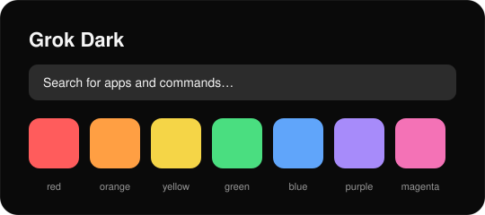
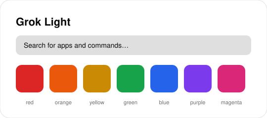

<div align="center">

# Grok for Raycast

Minimalistyczne, monochromatyczne motywy dla [Raycast](https://raycast.com) inspirowane estetyką Grok — w wersji **Dark** i **Light**.

</div>

<p align="center"> </p>
## Instalacja

> [!NOTE]
> Własne motywy wymagają [Raycast Pro](https://raycast.com/pro).

| Motyw | Instalacja | Podgląd |
|---|---|---|
| **Grok Dark** | [**Dodaj do Raycast →**](https://ray.so/themes?author=Maciej%20Szamowski&authorUsername=szamski&version=1&name=Grok%20Dark&appearance=dark&colors=%230A0A0A,%231A1A1A,%23F5F5F5,%23FFFFFF,%23FFFFFF,%23FF5C5C,%23FF9F43,%23F5D547,%234ADE80,%2360A5FA,%23A78BFA,%23F472B6&addToRaycast) | [ray.so/themes](https://ray.so/themes?author=Maciej%20Szamowski&authorUsername=szamski&version=1&name=Grok%20Dark&appearance=dark&colors=%230A0A0A,%231A1A1A,%23F5F5F5,%23FFFFFF,%23FFFFFF,%23FF5C5C,%23FF9F43,%23F5D547,%234ADE80,%2360A5FA,%23A78BFA,%23F472B6) |
| **Grok Light** | [**Dodaj do Raycast →**](https://ray.so/themes?author=Maciej%20Szamowski&authorUsername=szamski&version=1&name=Grok%20Light&appearance=light&colors=%23FFFFFF,%23F2F2F2,%230A0A0A,%23000000,%23000000,%23DC2626,%23EA580C,%23CA8A04,%2316A34A,%232563EB,%237C3AED,%23DB2777&addToRaycast) | [ray.so/themes](https://ray.so/themes?author=Maciej%20Szamowski&authorUsername=szamski&version=1&name=Grok%20Light&appearance=light&colors=%23FFFFFF,%23F2F2F2,%230A0A0A,%23000000,%23000000,%23DC2626,%23EA580C,%23CA8A04,%2316A34A,%232563EB,%237C3AED,%23DB2777) |

Po imporcie wybierz motyw w **Raycast → Settings → Appearance → Theme** albo komendą **Switch Theme**.

<details>
<summary>Instalacja bez przeglądarki (deeplink)</summary>

**Grok Dark**

```sh
open 'raycast://theme?author=Maciej%20Szamowski&authorUsername=szamski&version=1&name=Grok%20Dark&appearance=dark&colors=%230A0A0A,%231A1A1A,%23F5F5F5,%23FFFFFF,%23FFFFFF,%23FF5C5C,%23FF9F43,%23F5D547,%234ADE80,%2360A5FA,%23A78BFA,%23F472B6'
```

**Grok Light**

```sh
open 'raycast://theme?author=Maciej%20Szamowski&authorUsername=szamski&version=1&name=Grok%20Light&appearance=light&colors=%23FFFFFF,%23F2F2F2,%230A0A0A,%23000000,%23000000,%23DC2626,%23EA580C,%23CA8A04,%2316A34A,%232563EB,%237C3AED,%23DB2777'
```

</details>

## Paleta

### Grok Dark

| Rola | Kolor |
|---|---|
| `background` |  `#0A0A0A` |
| `backgroundSecondary` |  `#1A1A1A` |
| `text` |  `#F5F5F5` |
| `selection` |  `#FFFFFF` |
| `loader` |  `#FFFFFF` |
| `red` |  `#FF5C5C` |
| `orange` |  `#FF9F43` |
| `yellow` |  `#F5D547` |
| `green` |  `#4ADE80` |
| `blue` |  `#60A5FA` |
| `purple` |  `#A78BFA` |
| `magenta` |  `#F472B6` |

Źródło: [`grok-dark.json`](grok-dark.json)

### Grok Light

| Rola | Kolor |
|---|---|
| `background` |  `#FFFFFF` |
| `backgroundSecondary` |  `#F2F2F2` |
| `text` |  `#0A0A0A` |
| `selection` |  `#000000` |
| `loader` |  `#000000` |
| `red` |  `#DC2626` |
| `orange` |  `#EA580C` |
| `yellow` |  `#CA8A04` |
| `green` |  `#16A34A` |
| `blue` |  `#2563EB` |
| `purple` |  `#7C3AED` |
| `magenta` |  `#DB2777` |

Źródło: [`grok-light.json`](grok-light.json)

## Licencja

[MIT](LICENSE). Projekt nieoficjalny, niepowiązany z xAI ani Raycast.
